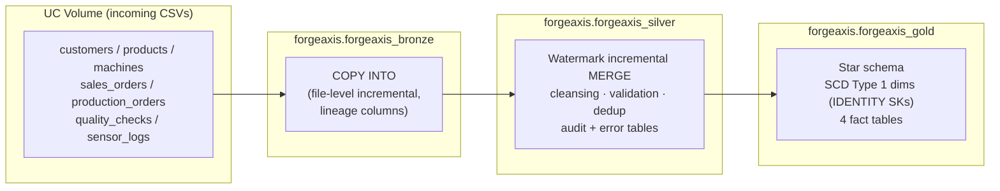

# ForgeAxis — Incremental Lakehouse Pipeline

**Databricks · Unity Catalog · PySpark · Delta Lake · Lakeflow Jobs**

An end-to-end medallion (Bronze → Silver → Gold) data platform for a fictional manufacturer, **ForgeAxis**. Seven source datasets — customers, products, machines, sales orders, production orders, quality checks, and IoT sensor logs — arrive as CSVs in a Unity Catalog Volume and flow through a **watermark-based incremental** pipeline into a Kimball-style star schema, orchestrated by a dependency-aware 22-task Databricks Job.

This repo contains **two generations of the project**, showing its evolution:

1. **`full_load/`** — the original v1 pipelines (schema creation, Bronze ingestion, two Bronze→Silver variants, SQL Gold full load)
2. **`incremental/`** — the rework: every layer processes **only new/changed rows** using watermark-based incremental `MERGE`, with audit logging, error quarantining, and idempotent replays

---

## Architecture



## Repository structure

```text
├── incremental/                        # v2 — incremental pipeline (current)
│   ├── 00_bronze_incremental_file_ingest.py   # all-datasets COPY INTO master
│   ├── bronze/      # 7 × per-dataset COPY INTO ingests
│   ├── silver/      # 7 × watermark-based Bronze→Silver MERGE pipelines
│   └── gold/        # 4 dimensions + 4 facts (Silver→Gold MERGE)
└── full_load/                          # v1 — original full-load pipelines
    ├── 01_manufacture_create_schema.ipynb
    ├── 02_forgeaxis_bronze_full_load.ipynb
    ├── 03_forgeaxis_silver_script.ipynb
    ├── 04_forgeaxis_silver_full_load_pipeline.ipynb
    └── 05_forgeaxis_gold_full_load_pipeline.ipynb
```

## How each layer works

### Bronze — file-driven ingestion with `COPY INTO`

* One stable incoming folder per dataset under `/Volumes/forgeaxis/forgeaxis_bronze/fg_bronze_data/incoming/<dataset>/`
* `COPY INTO` natively remembers loaded file paths and **skips them on re-runs** — drop a new CSV and only that file loads (no `FORCE = true`)
* Defensive typing with `try_cast` / `try_to_timestamp` — bad values become `NULL` instead of failing the batch
* Every row carries three lineage columns: `source_file`, `bronze_loaded_at` (the watermark driver), and a per-run UUID `batch_id`

### Silver — watermark-based incremental `MERGE`

Every silver notebook follows the same repeatable pattern:

1. **Checkpoint** — read its row from the shared `forgeaxis.forgeaxis_silver.watermark` table (seeded at `1900-01-01`, so the first run safely backfills everything)
2. **Snapshot pinning** — capture the Bronze Delta version via `DESCRIBE HISTORY` and read `versionAsOf`, freezing the batch boundary
3. **Delta selection** — `bronze_loaded_at > last_watermark AND <= upper_watermark`; exit cleanly with `NO_DATA` when nothing is new
4. **Cleansing & validation** — trims text, null-safe casts; rows failing checks get an `error_reason` and go to `silver_error_records` (dead-letter table), never into Silver
5. **Dedup** — window function keeps only the newest valid version per business key
6. **`MERGE` on the business key** — idempotent upsert stamping `batch_id` + `silver_loaded_at`
7. **Advance the watermark only after the MERGE commits** — a failure leaves the checkpoint in place, so a rerun is always safe (at-least-once delivery + key-based MERGE = effectively exactly-once)
8. Every run writes a row to `pipeline_audit` (source/silver/rejected counts, status, timings)

### Gold — star schema

* **Dimensions** (`dim_customer`, `dim_product`, `dim_machine`) — same watermark pattern from Silver, SCD **Type 1** semantics: `MERGE` on the business key, update changed attributes with null-safe `<=>` comparisons, and **never replace an existing surrogate key**; new rows omit the SK so the Databricks **IDENTITY** column generates it
* **`dim_date`** — generated from a date range (`sequence` + `explode`) with a smart `YYYYMMDD` integer `date_key`; pre-validated for nulls/duplicates; inserts only missing dates (idempotent, no watermark needed)
* **Facts** (`fact_sales_orders`, `fact_production_orders`, `fact_quality_checks`, `fact_sensor_logs`) — resolve surrogate keys by joining dimensions on business keys; dimension uniqueness and row-count preservation are verified **before** the MERGE, so no fact row ever ships with a NULL or wrong surrogate key

## Orchestration & scheduling

The whole flow is wired as a single Databricks (Lakeflow) Job with a **22-task DAG** on serverless compute, `max_concurrent_runs = 1`, hourly periodic trigger, and email notifications on start/success/failure.

* 7 Bronze tasks + `dim_date` run in parallel
* Silver tasks fan in on real data-model dependencies — e.g. `silver_sales_orders` waits on its Bronze task **and** `silver_customers` / `silver_products` (FK validation); `silver_sensor_logs` waits on `silver_production_orders` + `silver_machines`
* Each Gold dimension waits on its Silver source; each fact waits on its Silver source **and** every dimension it joins

## Design decisions

| Decision | Rationale |
| --- | --- |
| `COPY INTO` over Auto Loader | Hourly batch cadence; simple, cheap, re-runnable file-level incremental — no continuous streaming needed |
| Watermark + `MERGE` over full reloads | Gold tables (100K+ fact rows) absorb only the new slice each run — that's the point of incremental |
| Watermark advanced after the MERGE | Failure between the two transactions is safe to replay — no data loss, no duplicates |
| Business-key MERGE everywhere | Idempotent by construction; reruns can't double-insert |
| IDENTITY surrogate keys | Generated by Databricks; facts join dims on stable SKs |
| Quarantine over rejection | Bad rows land in `silver_error_records` with reasons instead of blocking the batch |
| Per-run `batch_id` + `loaded_at` columns | Every row is traceable to a source file and a pipeline run |

## Data quality & auditability

* `forgeaxis.forgeaxis_silver.watermark` — one checkpoint row per pipeline (14 pipelines: 7 Silver + 7 Gold)
* `forgeaxis.forgeaxis_silver.pipeline_audit` — per-run row counts, durations, and status
* `forgeaxis.forgeaxis_silver.silver_error_records` — dead-letter table with first-match `error_reason`

## Getting started

**Prerequisites**

* A Databricks workspace with Unity Catalog (serverless compute)
* Catalogs/schemas: `forgeaxis.forgeaxis_bronze`, `forgeaxis.forgeaxis_silver`, `forgeaxis.forgeaxis_gold`
* Volume `forgeaxis.forgeaxis_bronze.fg_bronze_data` with `incoming/<dataset>/` folders
* Full-load Gold tables must exist first (see `full_load/`) — the incremental notebooks MERGE into them

**Run order**

1. Drop new CSVs into the dataset incoming folders
2. Run Bronze (per dataset, or the all-datasets master)
3. Run the matching Silver pipeline
4. Run Gold: dimensions before facts (`dim_date` → dims → facts)

Or simply run the orchestrated Job, which encodes this entire order as its task DAG.
